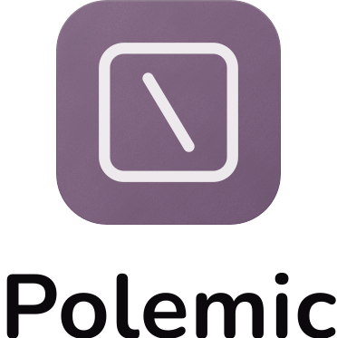
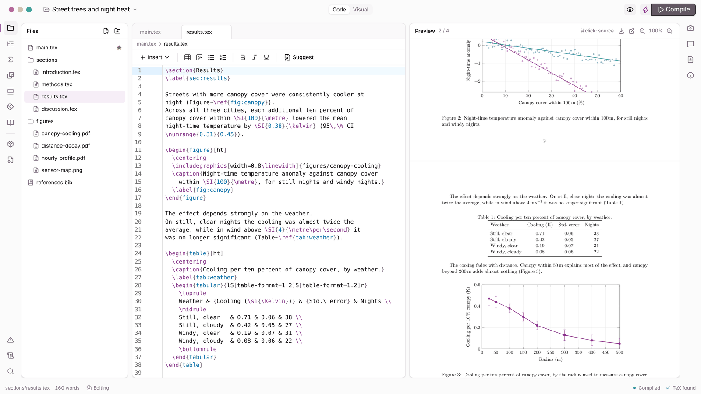

<p align="center">
  <a href="https://polemicapp.com">
    <picture>
      <source media="(prefers-color-scheme: dark)" srcset="assets/logo/polemic-lockup-icon-vertical-white.svg">
      
    </picture>
  </a>
</p>

<p align="center">
  <strong>Write, compile, revise</strong><br>
  A modern LaTeX editing experience, with a live PDF preview, comments and review links.
</p>

<p align="center">
  <a href="https://github.com/dwarsbit/polemic/actions/workflows/ci.yml"></a>
  <a href="https://github.com/dwarsbit/polemic/releases"></a>
  <a href="LICENSE"></a>
  <a href="https://polemicapp.com/download"></a>
</p>

<p align="center">
  <a href="https://polemicapp.com">Website</a> ·
  <a href="https://polemicapp.com/docs">Documentation</a> ·
  <a href="https://polemicapp.com/download">Download</a>
</p>

<p align="center">
  
</p>

Polemic is an open-source desktop editor for LaTeX, for macOS, Windows and
Linux. It compiles with the TeX distribution on your machine and keeps your
files where they are. Polemic Professional adds online services: review
links, grammar checking in almost every language and cloud compile. The
[documentation](https://polemicapp.com/docs) covers installation, your first
project and every feature below.

## Features

### Write

- **Code editor**: completion for commands, environments, labels and
  citations across your whole project, with math previews as you write.
- **Visual editor**: your paper as a document, with headings, lists, math
  and figures shown as they look. Anything Polemic doesn't model stays
  exactly as you wrote it.
- **Assets**: all your images and PDFs in one place, with tags and search.
  Insert a figure with the right path and width.
- **BibTeX and Zotero**: every entry in your bibliography, searchable, with
  unused and missing entries marked. Cite from Zotero too.
- **Grammar checking**: spelling and grammar underlined as you write, in
  English. Polemic Professional adds almost every language.

### Compile

- **Live PDF with SyncTeX**: the PDF updates next to your source. Go from
  the PDF to the LaTeX and back.
- **Fixes for compile errors**: one-click fixes for common errors. For the
  rest, ask the assistant.
- **Assistant** (optional, your own AI provider): a chat that reads your
  project and helps with LaTeX errors, packages, tables and layout. You
  review every change.
- **Cloud compile** (Polemic Professional): compile online, with no TeX
  distribution to install.

### Revise

- **Comments**: mark passages with comments by category, from "Source
  needed" to "Wording", without touching the LaTeX.
- **Review links** (Polemic Professional): reviewers read your paper in
  their browser and comment, and their comments arrive in your editor.
- **Snapshots and Git**: keep the history of your project with built-in
  snapshots or Git, and push to GitHub or GitLab.

Projects you receive from others are safe to open and compile: Polemic runs
`latexmk` with `-norc`, so a `latexmkrc` inside the project never runs
(your own `~/.latexmkrc` still applies), and Git runs with every
command-running setting of the project's `.git/config` blanked and hooks
switched off. See the [security page](https://polemicapp.com/docs/reference/security).

## Compared with Overleaf and TeXstudio

| | Polemic | Overleaf | TeXstudio |
| --- | --- | --- | --- |
| Runs on | Desktop | Browser | Desktop |
| Works offline | Yes | No | Yes |
| Files on your own machine | Yes | No | Yes |
| Open source | Yes | Yes | Yes |
| Visual editor | Yes | Yes | No |
| Live PDF preview | Yes | Yes | Yes |
| SyncTeX | Yes | Yes | Yes |
| Compile without installing TeX | Professional | Yes | No |
| Comments | Yes | Yes | No |
| Review links | Professional | Yes | No |
| Edit together in real time | No | Yes | No |

- **Compared with Overleaf**: Overleaf runs in the browser, and co-authors
  can edit together in real time. Polemic runs on your desktop and works
  offline. Reviewers comment from a link, and their comments come back to
  your editor.
- **Compared with TeXstudio**: both are desktop editors that compile with
  your own TeX distribution. Polemic adds a visual editor, comments, Zotero
  and review links.
- **Switching to Polemic**: your projects work as they are. Polemic opens
  any folder of LaTeX files, whether it comes from Overleaf or TeXstudio.

The full comparison is on the [compare page](https://polemicapp.com/compare).

## Develop

Polemic is a Tauri app: a React front end in `src/` and a Rust back end in
`src-tauri/`.

### Requirements

- Node.js 20 or later and pnpm
- Rust (stable) with cargo
- A TeX distribution on your PATH: TeX Live, MacTeX or MiKTeX, including
  `latexmk`

### Run

```bash
pnpm install
pnpm tauri dev
```

### Check

CI runs the same checks on every pull request.

```bash
pnpm lint
pnpm test
cd src-tauri && cargo test
```

### Build

```bash
pnpm tauri build
```

### More

- [Sign in with GitHub and GitLab](docs/sign-in.md): how the sign-in
  buttons work and how a fork uses its own OAuth apps
- [The browser build](docs/web.md): the same front end in a browser,
  for the Polemic server
- [Releasing](docs/releasing.md): how a version is built and published
- [Code signing](docs/signing.md): the secrets that sign the macOS and
  Windows builds
- [Content style](CONTENT.md): the rules for all public text, from the
  Polemic design system. Change them there first.

## License

[MIT](LICENSE)
